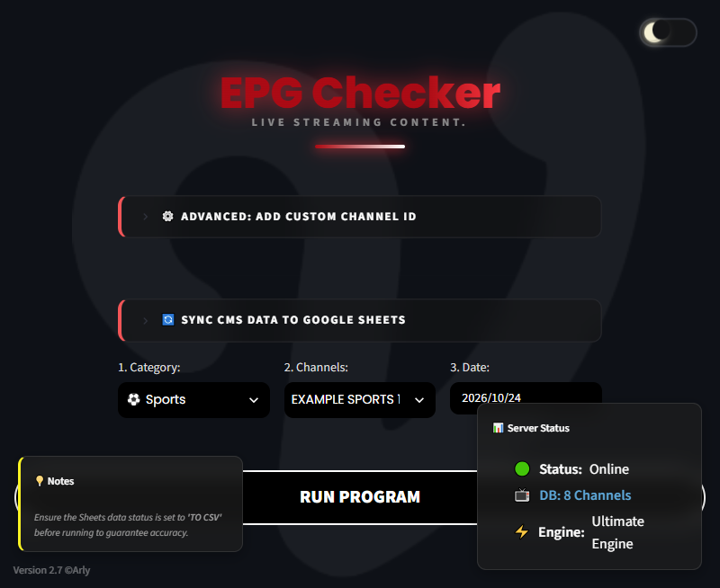
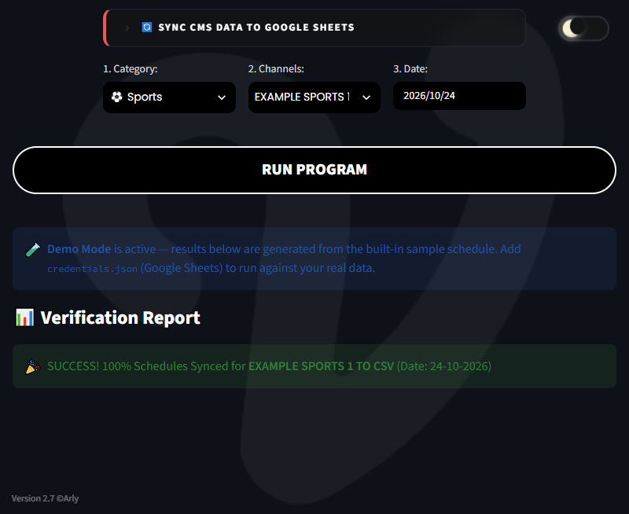

# 📺 EPG Checker

[](https://www.python.org/)
[](https://streamlit.io/)
[](https://www.selenium.dev/)
[](https://pandas.pydata.org/)

**Alat quality assurance untuk jadwal siaran TV live-streaming.**
Dashboard Streamlit + otomasi browser headless yang memverifikasi, memvalidasi, dan
mensinkronkan Electronic Program Guide (EPG) sebuah platform live-streaming
dengan CMS siarannya — setiap hari, secara otomatis.

> 🧪 **Ini adalah versi showcase yang sudah disanitasi.** Semua data perusahaan
> (ID spreadsheet, endpoint CMS, katalog channel, cookie session, kunci
> service account, dan URL webhook) sudah diganti dengan placeholder atau data contoh.

---

## 🎯 Masalah yang Dipecahkan

Sebuah platform live-streaming menyiarkan puluhan channel TV linear (24/7). Setiap
hari, tim editorial menjadwalkan ratusan program di Google Sheets (EPG), yang lalu
dipublish ke website publik dan CMS internal.

Ketika EPG dan CMS tidak sinkron, penonton melihat:
- ❌ Layar mati / dead air karena ada celah jadwal
- ❌ Program yang salah di jam yang salah
- ❌ Program yang tidak pernah tayang sama sekali

Pengecekan **manual untuk ~40 channel × 2 hari** adalah pekerjaan lambat dan rawan
salah, setiap hari. Tool ini mengotomasikannya dari ujung ke ujung.

## ✨ Fitur Utama

| Fitur | Deskripsi |
| --- | --- |
| 🔍 **Verifikasi EPG Otomatis** | Mencocokkan jadwal spreadsheet dengan website publik + CMS untuk *hari ini* dan *besok*. |
| ⏱️ **Gap Detector Engine** | Menandai setiap celah antar dua program berurutan, termasuk aturan toleransi 1 menit. |
| 🌙 **Cek Cakupan Akhir Hari** | Mendeteksi jadwal yang tidak sampai tengah malam (`23:59` / lintas tengah malam) — penyebab dead air klasik. |
| 🧠 **Fuzzy Title Matching** | Pipeline normalisasi (tanda baca, petik, strip, huruf besar/kecil) + irisan kata kunci, sehingga judul berbeda format tetap cocok. |
| 🟡 **Klasifikasi Revisi Manual** | Algoritma skor overlap dengan rumus penalti durasi untuk membedakan program yang *disesuaikan* vs *diganti*. |
| 🔄 **Sync Sheet yang Aman** | Paste tabel CMS → aplikasi hanya mengganti baris tanggal target, tidak pernah menyentuh tanggal lain. |
| 📦 **Manajer Channel Kustom** | Tambah channel baru + Live Stream ID langsung dari UI; tersimpan di database JSON lokal. |
| 🤖 **Otomasi Headless** | Selenium (Firefox/Chrome, headless) dengan auto-scroll, klik tab tanggal, ekspansi "show more", dan auto-retry saat jaringan lambat. |
| 🎨 **UI Modern** | CSS kustom, toggle tema gelap/terang, panel glassmorphism, animasi loading. |

## 🖼️ Screenshot

| Dashboard (Mode Gelap) | Laporan Verifikasi |
| :---: | :---: |
|  |  |

> Menjalankan aplikasi tanpa credential otomatis mengaktifkan **Mode Demo** dengan
> jadwal contoh bawaan — semua yang tampil di atas bisa direproduksi dalam hitungan detik.

## 🏗️ Arsitektur

```
┌─────────────────────┐      ┌──────────────────────┐
│   Google Sheets     │      │  Website Publik +    │
│  (sumber kebenaran  │      │  CMS (yang dilihat   │
│   EPG, per-tab per  │      │   penonton)          │
│   channel)          │      │                      │
└──────────┬──────────┘      └──────────┬───────────┘
           │  gspread API               │  Selenium (browser headless)
           ▼                            ▼
┌──────────────────────────────────────────────────┐
│                 CORE ENGINE (pandas)             │
│  • Normalisasi kolom & tanggal                   │
│  • Gap detector                                  │
│  • Cek cakupan akhir hari                        │
│  • Fuzzy title matching                          │
│  • Skor overlap (rumus penalti durasi)           │
└──────────────────────┬───────────────────────────┘
                       │
                       ▼
              ┌───────────────────┐
              │    Streamlit UI   │
              │  (verifikasi on-  │
              │       demand)     │
              └───────────────────┘
```

Aplikasi utama adalah **`daily_generator.py`** — satu file yang berisi seluruh alur:
baca EPG dari Google Sheets → jalankan validasi → ambil data website & CMS via
Selenium → tampilkan laporan di dashboard.

## 🚀 Cara Menjalankan

### 1. Install dependensi

```bash
git clone https://github.com/Arlyanto/epg-checker.git
cd epg-checker
pip install -r requirements.txt
```

### 2. Jalankan Mode Demo (tanpa setup apa pun) 🎉

```bash
streamlit run daily_generator.py
```

Tanpa credential, aplikasi otomatis berjalan dalam **Mode Demo** memakai jadwal
contoh bawaan, jadi kamu bisa langsung menjelajahi seluruh UI dan mesin validasinya.

Di Windows juga tersedia launcher sekali klik: **`Mulai_EPG_Checker.bat`**.

### 3. Hubungkan dengan data asli

| Rahasia | Letak | Catatan |
| --- | --- | --- |
| Google Sheets service account | `credentials.json` (root repo) **atau** `.streamlit/secrets.toml` di bawah `[gcp_service_account]` | Share spreadsheet ke email service account-nya. |
| URL Spreadsheet | Konstanta `URL_SPORT` / `URL_NON_SPORT` di `daily_generator.py` | Satu spreadsheet per kategori, satu tab per channel. |
| Session cookie CMS | `cookies.json` → `{"cookie_string": "..."}` | Untuk bagian CMS di dashboard. |

> ⚠️ Semua rahasia terdaftar di `.gitignore` — cek ulang sebelum commit.

Untuk menyiapkan sesi login CMS sekali jalan, jalankan `setup_firefox_profile.py`
(lakukan login manual di Firefox yang terbuka, lalu tekan ENTER).

## 📂 Struktur Proyek

```
epg-checker/
├── daily_generator.py           # Aplikasi utama — dashboard Streamlit
├── Mulai_EPG_Checker.bat        # Launcher sekali klik (Windows)
├── setup_firefox_profile.py     # Setup sesi login CMS sekali jalan (Firefox)
├── custom_channels.json         # Peta channel → live stream ID (kustom)
├── packages.txt                 # Paket sistem (Debian/Ubuntu) untuk Chromium
├── requirements.txt
├── logo_v.jpeg                  # Favicon
├── bg_dark.png / bg_light.png   # Background tema
├── mata_robot.png               # Aset desain
├── assets/                      # Screenshot untuk README
└── README.md
```

## 📐 Aturan Validasi

1. **Aturan gap** — `end_time(n)` harus sama dengan `start_time(n+1)` (atau berjarak tepat 1 menit). Selain itu dianggap celah.
2. **Aturan cakupan** — program terakhir hari harus berakhir `00:00`, `23:59`, `24:00`, atau lintas tengah malam.
3. **Aturan fuzzy match** — sebuah program spreadsheet cocok dengan program CMS/website ketika:
   - judul setelah normalisasi saling substring, **atau**
   - ≥ 2 kata signifikan beririsan (kata penghenti seperti *live*, *replay*, *vs* diabaikan), **atau**
   - slot waktu overlap cukup besar untuk jadi skor tertinggi di rumus penalti durasi.

## 📈 Dampak

- ⏱️ **Dari ~1 jam pengecekan manual jadi sekali klik.**
- 📺 **~40 channel × 2 hari** terverifikasi otomatis setiap kali dijalankan.
- 🐛 Risiko dead air (gap, cakupan tidak lengkap, entri CMS hilang) tertangkap **sebelum siaran**.
- 📊 Laporan langsung terbaca di dashboard, tanpa rekap spreadsheet manual.

## 🧰 Teknologi

`Python 3` · `Streamlit` · `pandas` · `BeautifulSoup4` · `Selenium` + `webdriver-manager` · `gspread` + `google-auth` · `Pillow`

## ⚖️ Penafian

Repositori ini adalah **showcase portofolio**. Domain, ID spreadsheet, katalog
channel, credential, dan URL webhook semuanya placeholder. Logika scraping
diperuntukkan bagi platform yang kamu miliki atau berwenang diuji.

---

Dibuat dengan ❤️ oleh [Arlyanto](https://github.com/Arlyanto)
